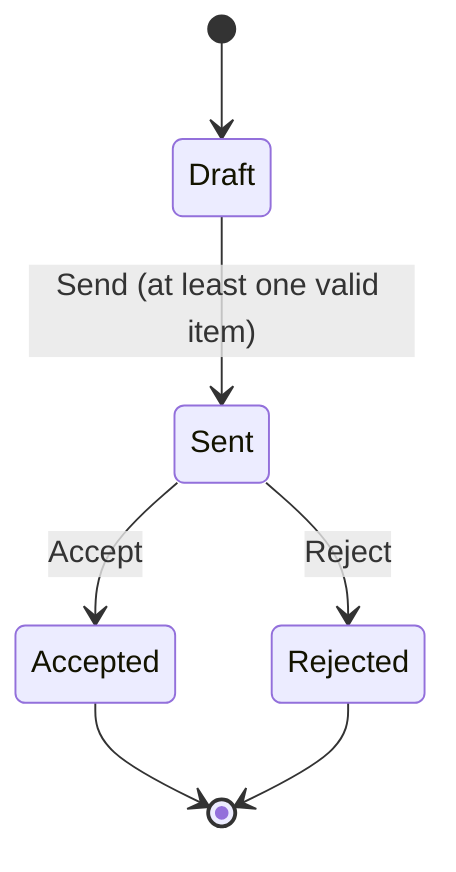

# Mini CRM - Requirements Specification

## 1. Document Overview

### 1.1 Purpose

This document defines the functional requirements, non-functional requirements, user roles and permissions, business rules, and user stories for Mini CRM.

Mini CRM is a web-based customer and quotation management system designed for small and medium-sized businesses. It is being developed as part of a 20-working-day Full-Stack Software Development Internship.

### 1.2 Scope

The initial release focuses on authentication, role-based authorization, customer management, customer archiving, quotation management, quotation calculations, quotation status tracking, and dashboard analytics.

User management, company settings, and activity history are secondary features. PDF export is optional. These features shall not delay delivery of the mandatory requirements.

### 1.3 Document Status

| Property | Value |
|---|---|
| Version | 1.0 |
| Status | Proposed baseline — pending approval |
| Related Documents | [Project README](../README.md), [Preliminary API Contracts](api-contracts.md) |

### 1.4 Requirement Priorities

| Priority | Description |
|---|---|
| Must Have | Mandatory for the initial release. |
| Should Have | Important but may be deferred if time is limited. |
| Could Have | Optional and implemented only if time permits. |

## 2. Functional Requirements

### FR-01 — Authentication

**Priority:** Must Have

The system shall allow users to authenticate using valid credentials, access protected resources, and securely log out. Invalid credentials shall be rejected.

### FR-02 — Role-Based Authorization

**Priority:** Must Have

The system shall enforce role-based access control according to the defined permissions for Admin and Sales Employee roles. Authorization shall be enforced by the backend for every protected operation.

### FR-03 — Customer Management

**Priority:** Must Have

The system shall allow authorized users to create, view, list, and update customer records. Customer details shall include access to the customer's associated quotation history.

### FR-04 — Customer Search & Filtering

**Priority:** Must Have

The system shall allow authorized users to search customers by name, company name, or email and filter records by archival status.

### FR-05 — Customer Archiving

**Priority:** Must Have

The system shall allow administrators to archive customers without permanently deleting their records or associated quotation history.

### FR-06 — Quotation Management

**Priority:** Must Have

The system shall allow authorized users to create, list, and view customer quotations and update quotations while they are in Draft status. Users shall be able to search quotations by reference number and filter them by status or associated customer.

### FR-07 — Quotation Items

**Priority:** Must Have

The system shall allow authorized users to add, update, and remove line items within draft quotations.

### FR-08 — Quotation Calculations

**Priority:** Must Have

The system shall calculate quotation line totals and the overall quotation amount automatically. The backend shall be the authoritative source for all financial calculations.

### FR-09 — Quotation Status Management

**Priority:** Must Have

The system shall allow authorized users to change quotation statuses according to the defined quotation state machine and reject invalid state transitions.

### FR-10 — Dashboard & Analytics

**Priority:** Must Have

The system shall provide a dashboard displaying customer counts, quotation counts, quotation status distribution, aggregated quotation values, and a sales activity overview. Quotation values shall not be presented as collected revenue.

### FR-11 — User Management

**Priority:** Should Have

The system should allow administrators to create, update, and deactivate user accounts and manage their assigned roles.

### FR-12 — Company Settings

**Priority:** Should Have

The system should allow administrators to view and update company information and general application settings.

### FR-13 — Activity History

**Priority:** Should Have

The system should record significant user actions, including customer and quotation changes, and allow administrators to review audit records.

### FR-14 — PDF Export

**Priority:** Could Have

The system may allow authorized users to export customer quotations as downloadable PDF documents.

## 3. Non-Functional Requirements

### NFR-01 — Security

- The system shall hash user passwords using an established password hashing mechanism and shall not store plaintext passwords.
- All protected API endpoints shall validate authentication credentials and enforce role-based permissions.
- Requests without valid authentication, including invalid or expired tokens, shall result in a `401 Unauthorized` response.
- Authenticated requests without the required permissions shall result in a `403 Forbidden` response.
- Production communication shall use HTTPS.
- Secrets shall not be committed to the source code repository.
- The backend shall validate incoming data independently of frontend validation.

### NFR-02 — Performance

- The 95th percentile response time (p95) for customer and quotation list endpoints shall not exceed 500 milliseconds under a test workload of 10 concurrent users.
- The test dataset shall contain at least 1,000 customers and 5,000 quotations.
- Customer and quotation list endpoints shall support pagination. The default page size shall be 20 records.
- The test environment, workload duration, request mix, and results shall be documented when performance testing is conducted.

### NFR-03 — Maintainability

- The application shall separate presentation, business logic, and data access concerns.
- Authoritative business rules shall be centralized in the backend rather than embedded in UI components or duplicated across API controllers. Frontend validation and calculation previews may mirror these rules for usability.
- Frontend linting and type checking shall pass without errors.
- The backend solution shall build without compilation errors.
- Automated tests shall cover quotation calculations and valid and invalid status transitions.

### NFR-04 — Responsive Design

- The application shall support viewport widths starting from 360px without unintended page-level horizontal overflow.
- Core user workflows shall remain usable at 360px, 768px, 1024px, and 1440px viewport widths.
- Data tables may use contained horizontal scrolling where necessary without causing page-level overflow.

### NFR-05 — Accessibility

- All interactive controls in core workflows shall be accessible using a keyboard.
- Form inputs shall have associated labels and accessible validation messages.
- Normal text shall have a contrast ratio of at least 4.5:1 where applicable.
- Status information shall not be conveyed through color alone.
- Keyboard focus indicators shall be visible.

### NFR-06 — Reliability

- Multi-step database operations shall either complete successfully or roll back without leaving partial records.
- Unexpected server errors shall be logged and return a standardized error response without exposing sensitive information.
- The frontend shall display appropriate loading, empty, error, and success states where applicable.

### NFR-07 — Data Integrity

- Each quotation shall reference an existing customer through a database foreign key.
- Quotation reference numbers shall be unique and enforced by a database constraint.
- Quotation item quantities shall be greater than zero.
- Quotation item unit prices shall be non-negative.
- Database constraints shall enforce valid item quantities and unit prices.
- Financial values shall use fixed-precision numeric types appropriate to the agreed currency and rounding policy.

## 4. Roles and Permissions

### 4.1 User Roles

**Admin:** A system administrator who can perform customer and quotation operations, access the dashboard, archive customers, and access administrative features when implemented.

**Sales Employee:** A user who can manage customers and quotations and access the dashboard but cannot perform administrator-only operations.

### 4.2 Permission Matrix

| Permission | Admin | Sales Employee |
|---|:---:|:---:|
| View Customers | ✓ | ✓ |
| Create Customers | ✓ | ✓ |
| Update Customers | ✓ | ✓ |
| Archive Customers | ✓ | — |
| View Quotations | ✓ | ✓ |
| Create Quotations | ✓ | ✓ |
| Edit Draft Quotations | ✓ | ✓ |
| Change Quotation Status | ✓ | ✓ |
| View Dashboard | ✓ | ✓ |
| Manage Users | ✓ | — |
| Manage Company Settings | ✓ | — |
| View Audit Logs | ✓ | — |

**Legend:** ✓ = Allowed; — = Not allowed.

### 4.3 Authorization Rules

- All protected operations require valid authentication.
- The backend shall enforce the permission matrix regardless of frontend visibility.
- Both roles shall comply with all business rules; administrative privileges shall not bypass quotation restrictions.
- Administrative permissions for optional or deferred features apply only when those features are implemented.
- Record-level access restrictions and PDF export permissions remain subject to the decisions in Section 8.

## 5. Business Rules

### BR-01 — Customer Eligibility

A quotation shall only be created for an existing, non-archived customer.

### BR-02 — Minimum Quotation Items

A quotation shall contain at least one valid line item before its status can be changed from Draft to Sent. A draft may be saved without line items.

### BR-03 — Valid Quotation Items

Each quotation item shall have a quantity greater than zero and a non-negative unit price.

### BR-04 — Unique Quotation Reference

Each quotation shall have a unique reference number generated by the backend. The reference number shall remain unchanged throughout the quotation lifecycle.

### BR-05 — Quotation Modification

Quotation content and line items shall only be modified while the quotation is in Draft status. After sending, only permitted status transitions may change the quotation status; its content shall remain unchanged.

### BR-06 — Quotation Status Transitions

A newly created quotation shall have Draft status. A quotation shall not transition to Accepted or Rejected unless its current status is Sent. All status transitions shall follow the quotation state machine defined in Section 5.1.

### BR-07 — Customer Data Preservation

Customers associated with quotations shall not be permanently deleted. Such customers shall be archived instead, preserving their existing quotation history. Permanent customer deletion is outside the scope of the initial release.

### BR-08 — Backend Authority

The backend shall be the authoritative source for quotation calculations, authorization decisions, and business rule enforcement. The backend shall calculate line totals and the overall quotation amount from validated item data rather than trusting client-supplied totals.

### 5.1 Quotation State Machine

#### States

| State | Description |
|---|---|
| Draft | Initial state. The quotation content and items may be edited. |
| Sent | The quotation has been marked as sent to the customer. Its content is locked. |
| Accepted | The customer has accepted the quotation. Terminal state. |
| Rejected | The customer has rejected the quotation. Terminal state. |

#### State Diagram

#### Allowed Transitions

| Current State | Target State | Condition |
|---|---|---|
| Draft | Sent | The quotation contains at least one valid line item. |
| Sent | Accepted | The user is authorized and the customer has accepted the offer. |
| Sent | Rejected | The user is authorized and the customer has rejected the offer. |

All other state-changing transitions shall be rejected with `409 Conflict`. Repeated requests targeting the current state are addressed in Section 8.

Changing a quotation to Sent records its status; it does not imply automatic email delivery.

### 5.2 Quotation Calculation Rules

For the initial base calculation:

- `LineTotal = Quantity × UnitPrice`
- `QuotationTotal = Sum of LineTotals`

The backend shall calculate and persist or return authoritative totals using fixed-precision numeric arithmetic. Currency, rounding, and any future tax or discount treatment shall be resolved before financial calculations are finalized.

## 6. User Stories

### US-001 — Create Customer

**Related Requirements:** FR-03

As a sales employee,  
I want to create a customer,  
so that I can manage their quotations.

**Acceptance Criteria:**

- **Given** that I am authenticated and authorized to create customers, **when** I submit valid customer information, **then** the customer must be created successfully and appear in the customer list.
- **Given** that I submit invalid customer information, **when** the request is processed, **then** the system must reject it and no customer must be created.

### US-002 — User Authentication

**Related Requirements:** FR-01, FR-02

As a system user,  
I want to log in and log out securely,  
so that I can access the system according to my permissions.

**Acceptance Criteria:**

- **Given** that I have an active account, **when** I submit valid credentials, **then** I must be authenticated and receive access according to my role.
- **Given** that I submit invalid credentials, **when** I attempt to log in, **then** authentication must fail.
- **Given** that I am authenticated, **when** I log out, **then** the client must clear its authenticated state and the server must apply the agreed session termination policy.
- **Given** that I do not possess valid authentication, **when** I request a protected resource, **then** the request must be rejected with `401 Unauthorized`.

### US-003 — Search and Filter Customers

**Related Requirements:** FR-04

As a sales employee,  
I want to search and filter customers,  
so that I can find relevant customer records quickly.

**Acceptance Criteria:**

- **Given** that customer records exist, **when** I enter a search term or apply an archival-status filter, **then** only records matching the criteria must be returned.
- **Given** that no records match the criteria, **when** the request completes, **then** an empty result must be displayed.

### US-004 — View and Update Customer

**Related Requirements:** FR-03

As a sales employee,  
I want to view and update customer information,  
so that customer records remain accurate.

**Acceptance Criteria:**

- **Given** that an accessible customer exists, **when** I open the customer's details, **then** the system must display the customer information and associated quotation history.
- **Given** that I am authorized to update the selected customer, **when** I submit valid updated information, **then** the changes must be saved and displayed.

### US-005 — Archive Customer

**Related Requirements:** FR-02, FR-05

As an admin,  
I want to archive a customer,  
so that inactive customer records and their quotation history can be preserved.

**Acceptance Criteria:**

- **Given** that I am authenticated as an admin and an active customer exists, **when** I archive the customer, **then** the customer must be marked as archived and their existing quotations must be preserved.
- **Given** that the customer is archived, **when** the active-customer filter is applied, **then** the customer must not be included in the results.
- **Given** that a sales employee is authenticated, **when** they attempt to archive a customer, **then** the backend must reject the request with `403 Forbidden`.

### US-006 — Create and Manage Quotation

**Related Requirements:** FR-06, FR-07, FR-08

As a sales employee,  
I want to create and manage quotations with line items,  
so that I can prepare accurate offers for customers.

**Acceptance Criteria:**

- **Given** that an existing, non-archived customer is selected, **when** I submit a valid quotation, **then** it must be created in Draft status with a unique reference number and backend-calculated totals.
- **Given** that a quotation is in Draft status, **when** I add, update, or remove valid line items, **then** its contents and calculated totals must be updated accordingly.
- **Given** that a customer does not exist or is archived, **when** I attempt to create a quotation for that customer, **then** the request must be rejected.
- **Given** that accessible quotations exist, **when** I search by reference number or filter by status or customer, **then** only matching quotations must be returned and their details must be viewable.

### US-007 — Manage Quotation Status

**Related Requirements:** FR-06, FR-09

As a sales employee,  
I want to update quotation statuses,  
so that I can track customer decisions.

**Acceptance Criteria:**

- **Given** that a draft quotation contains at least one valid line item, **when** I mark it as Sent, **then** its status must change to Sent and its content must become locked.
- **Given** that a draft quotation contains no line items, **when** I attempt to send it, **then** the request must be rejected with `409 Conflict`.
- **Given** that a quotation is in Sent status, **when** I record the customer's acceptance or rejection, **then** its status must change to Accepted or Rejected accordingly.
- **Given** that I attempt a disallowed state transition or attempt to modify quotation content after sending, **when** the request is processed, **then** it must be rejected with `409 Conflict` and the existing data must remain unchanged.

### US-008 — View Dashboard

**Related Requirements:** FR-10

As an authorized system user,  
I want to view business statistics,  
so that I can monitor customer and quotation activity.

**Acceptance Criteria:**

- **Given** that I am authenticated as an Admin or Sales Employee, **when** I access the dashboard, **then** customer counts, quotation counts, status distribution, aggregated quotation values, and a sales activity overview must be displayed according to the agreed metric definitions.
- **Given** that no relevant records exist, **when** I access the dashboard, **then** the system must display appropriate zero-value or empty states without errors.

## 7. Requirements Traceability

The following matrix links the mandatory functional requirements to user stories and preliminary API endpoints. All API paths are relative to `/api`.

| Requirement | User Stories | Related API Endpoints |
|---|---|---|
| FR-01 | US-002 | `POST /auth/login`, `POST /auth/logout`, `GET /auth/me` |
| FR-02 | US-002, US-005 | All protected endpoints, including `PATCH /customers/{id}/archive` |
| FR-03 | US-001, US-004 | `GET /customers`, `GET /customers/{id}`, `POST /customers`, `PUT /customers/{id}`, `GET /quotations` (customer filter) |
| FR-04 | US-003 | `GET /customers` |
| FR-05 | US-005 | `PATCH /customers/{id}/archive` |
| FR-06 | US-006, US-007 | `GET /quotations`, `GET /quotations/{id}`, `POST /quotations`, `PUT /quotations/{id}` |
| FR-07 | US-006 | `POST /quotations`, `PUT /quotations/{id}` |
| FR-08 | US-006 | `POST /quotations`, `PUT /quotations/{id}` |
| FR-09 | US-007 | `PATCH /quotations/{id}/status` |
| FR-10 | US-008 | `GET /dashboard/summary` |
| FR-11 | Deferred | To be defined if selected for implementation |
| FR-12 | Deferred | To be defined if selected for implementation |
| FR-13 | Deferred | To be defined if selected for implementation |
| FR-14 | Optional | To be defined if selected for implementation |

Detailed API request and response schemas shall be maintained in [api-contracts.md](api-contracts.md) and expanded as features are developed. The matrix provides high-level coverage; additional positive and negative test cases will be defined during implementation.

## 8. Open Decisions

The following decisions require confirmation before implementation of the affected features. Proposed defaults are not approved requirements.

| ID | Topic | Decision Required / Proposed Default |
|---|---|---|
| OD-01 | JWT and session management | Define token transport, storage, expiration, refresh, and server-side logout/revocation behavior. |
| OD-02 | Customer validation | Define mandatory and optional fields, maximum lengths, and any uniqueness constraints. |
| OD-03 | Record-level access | Confirm whether sales employees can access all customers and quotations or only assigned records. |
| OD-04 | Archived customers | Define default list filtering, whether archived records may be edited or restored, and whether existing drafts for archived customers may be edited or sent. |
| OD-05 | Quotation reference format | Confirm the generation format; proposed example: `QUO-2026-0001`. |
| OD-06 | Currency and rounding | Confirm the supported currency, quantity precision, monetary precision, and rounding rules. Tax and discount support is not specified. |
| OD-07 | Dashboard metrics | Define inclusion of archived customers and quotation statuses, aggregation periods, and sales overview metrics. |
| OD-08 | API conventions | Confirm standardized error format, maximum page size, default ordering, and query parameter names. |
| OD-09 | Repeated requests and concurrency | Define behavior for repeated archive/status requests and concurrent quotation edits or status transitions. |
| OD-10 | Optional features | Confirm scope, permissions (including PDF export), and API contracts for FR-11 through FR-14 if selected. |
| OD-11 | Performance testing | Confirm the test environment, workload duration, and request mix for NFR-02. |
| OD-12 | Initial user provisioning | Define how Admin and Sales Employee accounts will be provisioned if the user management feature is deferred. |
